# Framework architecture

The framework separates process physics, control, fault injection, measurement corruption, scientific campaign generation, supervised fault recognition, healthy-only anomaly detection and operator presentation. The corresponding production model was accepted through staged engineering validation **before** synthetic faults were used as scientific evidence.

```mermaid
flowchart LR
    A[Supervisory modes 0–7<br/>Valve/pump sequencing] --> B[Command-to-actuator fault transformations]
    B --> C[Simscape Thermal Liquid<br/>TK-1 + four hydraulic paths]
    C --> D[Nominal physical QA<br/>mode, pressure, temperature, CIP]
    D -->|PASS| E[Scientific1900<br/>19 classes × 100 independent runs]
    E --> F[Causal windows<br/>60 s, 170 features]
    F --> G[Locked run split<br/>70/15/15 per class]
    G --> H[Class diagnosis + healthy-only anomaly]
    H --> I[Validation/calibration/explanation<br/>Streamlit advisory HMI]
```

## Process equipment

The reduced-order physical model represents a nominal 2,000 L Jameed mixing/heating vessel with production filling, holding/heating, product discharge and clean-in-place (CIP). Four controlled flow sources represent fill, discharge, CIP supply and CIP return. Heating and agitator actuation are modelled separately. The model uses imposed-flow components for the hydraulic actuation; this is **not** a plant-calibrated pump-characteristic study.

## Supervisory logic and CIP permissives

States are idle/complete (0), filling (1), heating/mixing (2), holding (3), discharge (4), CIP circulation (5), CIP drain (6), and fail-safe process hold (7). CIP begins only after adequate product drain is verified; valve-first/pump-second sequencing and flow ramps protect transitions. Product discharge and CIP supply are not commanded simultaneously in the accepted nominal case.

## True signals, measured signals and causality

Fault transformations modify effective physical actuation. Separate measurement transformations introduce sensor offset, scaling, drift, dropout or noise only into measured channels, preserving true-state records for simulator QA. Fault-class metadata must **not** be used as a diagnostic input feature. Labels are based on contemporaneous active-fault state, not a future run label applied indiscriminately to pre-fault windows.

## Inference and dashboard boundary

The Streamlit layer is an advisory/HMI consumer of recorded or simulated process telemetry and validation-selected models. It is not an autonomous plant safety controller. Future live PLC integration is not part of the locked scientific experiment.
